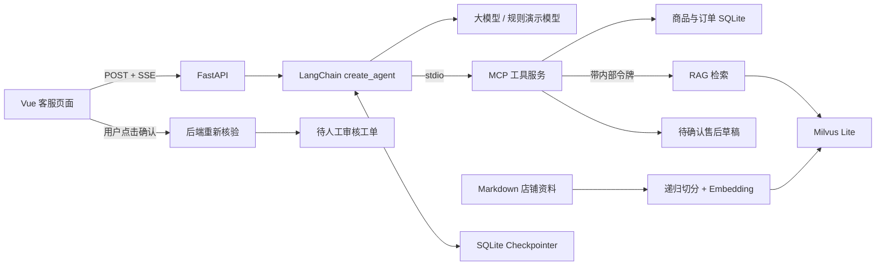

# 拾光商店 · 电商客服 Agent

一个用于复盘 **LangChain 1.x、Agent、MCP、RAG、Prompt、持久化记忆和流式输出** 的小型项目。前端 Vue 3，后端 FastAPI。商品、订单、买家均为虚构数据，可以直接运行，不依赖原来的复习系统。

客服叫「小拾」，支持：

- 查商品价格、库存和规格，不让模型凭记忆编造价格。
- 查当前演示买家的订单、状态和物流。
- 从店铺 Markdown 资料中检索配送、保修、退换货政策，并展示出处。
- 核验订单 → 生成售后草稿 → 用户在页面确认 → 登记待人工审核工单。
- 橙白主题、左右聊天气泡，客服先总结再简短回答。
- 流式回答、停止生成、历史对话恢复、两个演示买家切换。
- 在可展开的「服务详情」中查看本轮 MCP 工具过程，回答下可展开知识依据。

售后演示**不会调用支付接口、执行退款、修改真实订单**。切换演示买家是学习功能，不是真实身份认证。

## 1. 本地启动

建议 Python **3.12**、Node.js **22.12+**、uv。PyCharm 请将解释器选为本项目 `backend/.venv/bin/python`，不要沿用旧项目环境。

```bash
cd /Users/williams/Conda/xiaohan-commerce-agent
bash scripts/dev.sh
```

打开 **http://127.0.0.1:5175/**。首次运行会安装依赖；按 `Ctrl+C` 停止本脚本启动的服务。如果端口已占用，脚本会提示并退出。

也可以分别启动：

```bash
# 终端一：准备配置并启动后端
cd /Users/williams/Conda/xiaohan-commerce-agent
python3 scripts/setup_env.py
cd backend
uv sync --frozen --python 3.12
uv run --frozen uvicorn app.main:app --host 127.0.0.1 --port 8020 --no-proxy-headers
```

```bash
# 终端二：启动前端
cd /Users/williams/Conda/xiaohan-commerce-agent/frontend
npm ci
npm run dev
```

配置写在项目根目录 `.env`，与旧项目完全独立。修改后需重启后端；不会自动读取原项目的配置。

| 用途 | 本项目端口 | 原复习项目常用端口 |
| --- | --- | --- |
| 本地 Vue 开发页面 | 5175 | 5174 |
| 本地 FastAPI | 8020 | 8010 |
| Ubuntu Docker 网站入口 | **8891** | 8888 |

Docker 只公开前端 8891，后端 8020 留在独立容器网络内。项目名、Cookie 名、镜像名、数据库文件也单独设置。Milvus 使用本项目的 **Milvus Lite 文件库**，不会连接或修改 `localhost:19530`。

## 2. 先体验这些场景

默认买家 A「林同学」：

1. `降噪耳机多少钱？还有库存吗？` —— 商品工具返回 ¥399、库存 28 件。
2. `查一下 SG20260002 的物流` —— 查询保温杯的运输进度。
3. `七天无理由退货的运费谁承担？` —— 检索知识库，展开回答下的参考片段。
4. `为 SG20260001 申请退货，原因是不合适` —— 先核验规则，再生成草稿；到“订单与售后”点击「确认提交」。
5. `为 SG20260002 申请退货，原因是不需要了` —— 运输中订单不能自动受理，提示联系人工。

左下角切换为买家 B「陈同学」：

- `查一下我的订单` —— 只能看到 `SG20260003`。
- `查一下 SG20260001` —— 查不到买家 A 的订单。
- `为 SG20260003 申请取消订单，原因是不需要了` —— 待发货订单可登记取消申请，同样需要页面确认。

演示订单的签收日期以**首次初始化时间**为基准，重启不会重置。7 天后，最初的已签收订单会正常超出自动申请期限。需要重新演示时，可停止服务并备份后移走本项目数据目录，重新启动生成样例；不要删除原复习项目的数据。

## 3. 大模型与无 Key 演示

`.env` 有两个彼此独立的开关：

```dotenv
# true：受限的规则模型；false：真实大模型自主决定调用工具
DEMO_MODE=true

CHAT_MODEL=deepseek-chat
CHAT_API_KEY=
CHAT_BASE_URL=https://api.deepseek.com

# local / openai / dashscope
EMBEDDING_MODE=local
EMBEDDING_API_KEY=
EMBEDDING_BASE_URL=
EMBEDDING_MODEL=
```

**使用真实客服 Agent**：填写兼容 OpenAI 且支持 Tool Calling 的模型配置，将 `DEMO_MODE=false`，重启后端。当前本机和本次部署的 `.env` 已启用复制的 DeepSeek 配置；新环境运行配置生成脚本时默认仍为规则演示。密钥不会出现在 README、代码包或浏览器中。

**无需 Key 演示**：`DEMO_MODE=true` 使用自定义 `BaseChatModel` 按关键词选择工具，仍真实经过 `create_agent → MCP → SQLite/Milvus → SSE`，没有伪造工具结果。但它不具备大模型的语义理解和多轮推理能力，建议先用快捷问题学习链路；页面会明确标记「规则演示模式」。

向量模型不依赖聊天模型开关：

| 模式 | 配置方式 | 适用范围 |
| --- | --- | --- |
| `local` | 不需要 Embedding Key | 默认 512 维字符 n-gram 哈希向量，不下载模型；方便学习检索流程，不等同于语义 Embedding |
| `openai` | Key、模型名、含 `/v1` 的兼容地址 | 标准 `POST /embeddings` 文本向量服务 |
| `dashscope` | 百炼多模态 Key、模型名、如 `https://dashscope.aliyuncs.com/api/v1` | 百炼原生多模态 Embedding 接口；此地址不是 compatible-mode 地址 |

有 OpenAI 兼容地址时优先选择 `openai`，但要确认该部署支持标准 `/embeddings` 请求格式。不能仅凭模型名称判断接口协议。切换 Embedding 后重启，程序会检查指纹并重建**本项目**向量集合，维度读取实际向量长度。

如果首次生成配置时需要复制旧项目模型项，可在 `.env` 尚不存在时执行：

```bash
cd backend
uv sync --frozen --python 3.12
.venv/bin/python ../scripts/setup_env.py --copy-model-from /Users/williams/Conda/xiaohan-review-agent/.env
```

该操作只复制模型项，不复制数据库地址、管理员密码或会话签名密钥；已存在 `.env` 时不会覆盖。

## 4. 代码如何串起来



| 学过的技术 | 本项目落点 |
| --- | --- |
| Agent 与 Tool Calling | `backend/app/agent.py`：`create_agent`、模型自主调用工具 |
| Prompt | 同文件 `SYSTEM_PROMPT`：业务边界、工具选择、事实来源、售后确认 |
| MCP | `mcp_server.py` 声明 4 个工具；`agent.py` 用 `MultiServerMCPClient` 加载 |
| RAG / 切分 / Embedding / Milvus | `knowledge.py`：Markdown → 切片 → 向量 → 检索与出处 |
| 多轮持久化记忆 | `AsyncSqliteSaver`，thread_id 由访客、客户、会话组成 |
| 业务数据与历史展示 | `store.py`：参数化 SQL、归属校验、事务、幂等确认 |
| 工具异常恢复 | `middleware.py`：中断后补齐匹配的 ToolMessage，减少下一轮 tool_calls 400 |
| SSE | `main.py` 输出 token/state/done；`frontend/src/stream.js` 解析分块 |
| Vue | `App.vue`：对话、工具轨迹、知识出处、确认面板 |

建议按 **store.py → mcp_server.py → agent.py → main.py → App.vue** 阅读。更细的复盘步骤见 [学习路线](docs/学习路线.md)，本次部署状态见 [验收与部署记录](docs/验收与部署记录.md)。

## 5. 修改商品和知识

- 修改 `knowledge/*.md`：用于 RAG 的政策和商品知识。程序检索时检查内容指纹，变更会自动切分入库；部署后重启后端可立即刷新页面的知识库统计。
- 商品价格、库存、订单属于结构化业务事实，由 `store.py` 查询 SQLite，**不靠政策文档充当实时库存库**。
- `store.initialize()` 只在首次初始化时插入样例，不覆盖已存在商品与订单。改种子后需迁移现有数据或在备份后使用全新数据目录。
- 添加工具：在 `mcp_server.py` 写一个带中文说明的 `@mcp.tool` 函数，再更新 `SYSTEM_PROMPT`；真实模型可直接选择它。规则模式还需在 `demo_model.py` 添加选择规则。
- 若替换成真实商城，先接登录和后端订单归属验证，再对接订单 API；不能把 `customer_id` 交给模型决定。

## 6. Ubuntu + Docker 部署

服务器建议 Linux x86_64、Docker Engine 和 Compose V2。不要复制 Mac 的 `.venv` 或 `node_modules`：Docker 按锁文件安装 Linux 环境。

### 上传独立项目

在 Mac 上生成不含密钥和本机数据的代码包：

```bash
cd /Users/williams/Conda/xiaohan-commerce-agent
python3 scripts/package_deploy.py --output /tmp/xiaohan-commerce-agent.tar.gz
scp /tmp/xiaohan-commerce-agent.tar.gz ubuntu@43.139.216.149:/tmp/
```

首次部署到 Ubuntu：

```bash
mkdir -p ~/apps
cd ~/apps
tar -xzf /tmp/xiaohan-commerce-agent.tar.gz
cd xiaohan-commerce-agent
python3 scripts/setup_env.py
nano .env
# 填入模型配置；想先验证页面可保留 DEMO_MODE=true
chmod 600 .env
ss -ltn 'sport = :8891'
docker compose config --quiet
docker compose build
docker compose up -d --no-build
docker compose ps
curl --fail http://127.0.0.1:8891/api/health
```

安全组/云防火墙放行 TCP **8891** 后访问 **http://43.139.216.149:8891/**。本项目不会更改原系统的 8888 服务或防火墙。

如果需要复用本机现有配置，在 Mac 单独安全上传 `.env`，不要放进公开仓库或代码包：

```bash
scp /Users/williams/Conda/xiaohan-commerce-agent/.env ubuntu@43.139.216.149:~/apps/xiaohan-commerce-agent/.env
```

Docker Hub 连接超时时，可以显式使用镜像代理构建；代理由第三方运营，替换成你可访问的可信地址即可：

```bash
docker compose build \
  --build-arg PYTHON_IMAGE=docker.m.daocloud.io/library/python:3.12-slim-bookworm \
  --build-arg NODE_IMAGE=docker.m.daocloud.io/library/node:22-alpine \
  --build-arg NGINX_IMAGE=docker.m.daocloud.io/library/nginx:1.28-alpine
```

Python 包默认从国内镜像下载，严格校验锁定版本和哈希。若镜像尚未同步某个版本，可添加 `--build-arg PYPI_INDEX=https://pypi.org/simple/` 重试；不要为了构建跳过锁文件或哈希。首次构建会下载依赖，后续会复用缓存。

### 更新、改配置和日志

```bash
cd ~/apps/xiaohan-commerce-agent
# 更新源码后：
docker compose build
docker compose up -d --no-build
# 只改 .env 后：必须重新创建容器，单纯 restart 不会更新 Compose 注入的环境变量
docker compose up -d --no-build --force-recreate backend
# 查看状态和日志
docker compose ps
docker compose logs --tail=100 backend
```

修改外部端口：改根目录 `.env` 的 `COMMERCE_HTTP_PORT=8891`，再 `docker compose up -d --no-build`，并放行新端口。8020 不需要在服务器安全组开放。

容器数据保存在 `runtime/data/`，停止和重建容器仍会保留。单机 demo 使用 **1 个 backend worker**，不要横向复制共享同一 Milvus Lite 文件的后端。备份时先 `docker compose stop backend`，复制整个 `runtime/data` 和知识文件，再启动后端；`.env` 另行安全备份，尤其保留 `SESSION_SECRET`，否则原浏览器凭据会失效。

## 7. 验证

```bash
cd backend
uv run --frozen python -m unittest discover -s tests -v
cd ../frontend
npm test
npm run build
```

后端集成测试启动临时 FastAPI，实际执行 LangChain → stdio MCP → Milvus/SQLite → SSE；测试身份隔离、售后显式确认、幂等、重启持久化。测试使用临时目录和规则模型，不调用付费服务、不修改本地/服务器业务数据。

本项目面向学习和小规模演示。浏览器通过签名随机 Cookie 隔离聊天；演示买家可随意切换，因此不能拿来保护真实客户订单。公开给大量用户之前，需要补真实认证、限流、模型费用额度和运营审计。它暂未接入支付、人工客服平台或真实物流服务。
